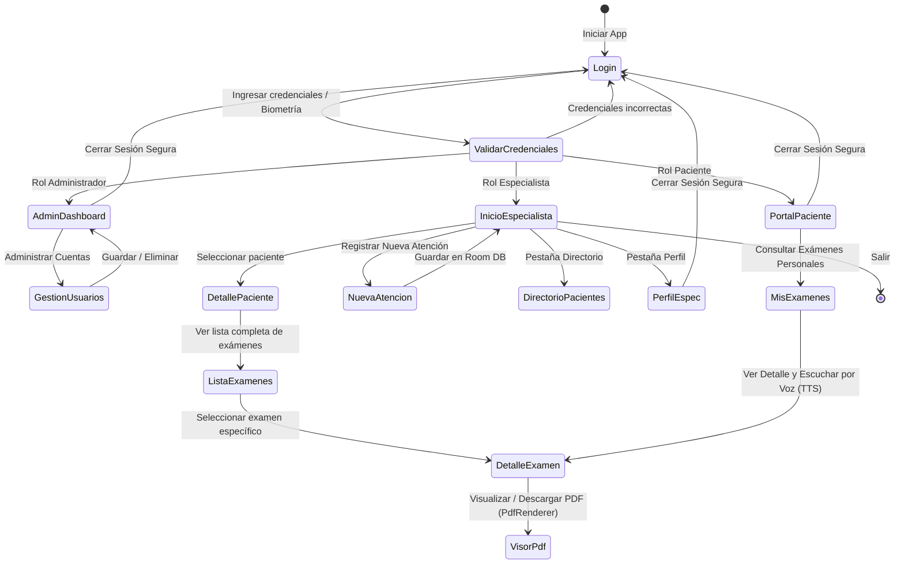

# Ocularis
**App móvil para consulta y trazabilidad de exámenes oftalmológicos**

Ocularis es una aplicación móvil desarrollada en Android (Jetpack Compose) orientada a centralizar, organizar y dar trazabilidad al acceso, gestión y consulta de exámenes e historiales clínicos oftalmológicos para especialistas, administradores y pacientes.

---

## 🎨 Identidad Visual
* **Logotipo:** 

  

* **Paleta de Colores Oficial:** 

| Color | Código | Vista Previa |
| :--- | :--- | :--- |
| **Fondo** | `#FFFFFA` |  |
| **Texto** | `#0D5C63` |  |
| **Secundario** | `#44A1A0` |  |
| **Adicional** | `#78CDD7` |  |
| **Principal** | `#247B7B` |  |

---

## 🏛️ Arquitectura y Base de Datos (3NF) y Persistencia Offline
El proyecto implementa el patrón **MVVM (Model-View-ViewModel)** junto con **Room Database (SQLite)** normalizada en **Tercera Forma Normal (3NF)** e integración con **InsForge Cloud API** para garantizar la persistencia local y sincronización offline:
* **Entidades (`Entities`):** `UsuarioEntity`, `PacienteEntity`, `EspecialistaEntity`, `AlertaClinicaEntity`, `ConsultaMedicaEntity`, `ExamenEntity`.
* **Acceso a Datos (`DAOs`):** Consultas reactivas basadas en **Kotlin Coroutines** y `Flow`.
* **Repositorio (`Repository`):** Capa única de verdad que alimenta al `AppViewModel`.
* **Poblador Inicial (`Seeder`):** Carga automática de registros clínicos de prueba al iniciar la aplicación.
* **Preferencias (DataStore):** Almacenamiento local de preferencias de accesibilidad y alto contraste.

---

## ♿ Accesibilidad Visual Obligatoria (WCAG 2.2 AA)
Ocularis incluye herramientas de accesibilidad para personas con baja visión o ceguera:
* **Alto Contraste Clínico:** Modo de contraste mejorado para lecturas diagnósticas (DataStore).
* **Escala Dinámica de Texto:** Ajuste de tamaño de fuente global (Normal 1.0x, Grande 1.25x, Extra Grande 1.5x).
* **Lector de Voz Integrado (TextToSpeech):** Botón de lectura en voz alta para informes y resultados de exámenes médicos.

---

## 📱 Pantallas Principales implementadas (MVP)
Todas las interfaces están construidas con **Jetpack Compose** y **Material 3**:
1. **Login (`LoginScreen.kt`):** Acceso seguro multirrol con validación dinámica acumulativa de contraseña, integración biométrica y servidor de autenticación.
2. **Dashboard Administrador (`AdminDashboardScreen.kt` & `GestionUsuariosScreen.kt`):** Panel de control con métricas operativas y gestión de altas/bajas de usuarios en el sistema.
3. **Inicio / Agenda del Especialista (`HomeScreen.kt`):** Listado dinámico de pacientes recientes y agenda pendiente del día.
4. **Nueva Atención (`AtencionScreen.kt`):** Formulario clínico con buscador autocomplete de pacientes de la base de datos, selector de fecha nativo y chips rápidos.
5. **Directorio de Pacientes e Historial (`HistorialScreen.kt`):** Consulta global de pacientes, exploraciones y exámenes sincronizados.
6. **Detalle del Paciente (`DetallePacienteScreen.kt`):** Expediente completo, datos de contacto, alertas oftalmológicas (miopía, glaucoma), próximo control e historial de consultas.
7. **Lista de Exámenes (`ListaExamenes.kt` & `MisExamenesScreen.kt`):** Pantalla para la consulta y filtrado de exámenes sincronizados para especialistas y pacientes.
8. **Detalle del Examen (`DetalleExamen.kt`):** Generación automática de PDF mediante `PdfDocument` y visualizador interactivo nativo con **`PdfRenderer`** (soporte de zoom, desplazamiento y síntesis de voz).
9. **Portal del Paciente (`PacienteHomeScreen.kt`):** Vista personalizada para pacientes con acceso a sus propios controles y exámenes.
10. **Perfil del Especialista (`PerfilScreen.kt`):** Panel del médico con estado de disponibilidad interactivo, estadísticas mensuales, credenciales y preferencias de accesibilidad.

---

## ⚡ Recursos Nativos de Android Integrados
* **Biometría Nativa (`BiometricPrompt`):** Autenticación por huella dactilar o reconocimiento facial en el Login.
* **Telefonía y Mensajería (`Intent.ACTION_DIAL` / `smsto:`):** Llamadas y envío de SMS directos a los pacientes desde su perfil.
* **Compartir del Sistema (`Android ShareSheet`):** Envío de informes clínicos a otras aplicaciones mediante `Intent.ACTION_SEND`.
* **Impresión y Visor PDF Nativo:** Generación con `PdfDocument` y renderizado de páginas con `PdfRenderer`.
* **Síntesis de Voz (`TextToSpeech`):** Lectura en voz alta en español del informe médico completo ("Escuchar Informe Completo 🔊").
* **Fecha y Hora (`DatePickerDialog`):** Selector de calendario nativo para agendamientos.

---

## 📊 Flujo de Usuario Multirrol

## Pantallas Principales
Los diseños de las interfaces de Ocularis se encuentran ubicados en el repositorio dentro del directorio `docs/diseno/interfaces/`. Las pantallas generadas para este MVP son:
* Login Multirrol (Admin, Especialista, Paciente)
* Dashboard Administrador y Gestión de Usuarios
* Inicio / Agenda y Búsqueda de Pacientes
* Registro de Nueva Atención Médica
* Directorio de Pacientes y Expedientes
* Historial y Lista de Exámenes
* Detalle de Examen con Visor PDF (`PdfRenderer`) y Síntesis de Voz (`TTS`)
* Portal del Paciente y Perfil del Especialista con Accesibilidad (DataStore)

## Tecnologías Utilizadas
* **Google Stitch:** Generación y prototipado de UI con IA.
* **coolors.co:** Definición de la paleta de colores.
* **planttext.com:** Generación del diagrama de flujo UML.
* **Material Design 3 (m3.material.io):** Sistema de diseño y componentes base.
* **Kotlin, Jetpack Compose, MVVM, Room, DataStore, Retrofit, PdfDocument, PdfRenderer, TextToSpeech.**

## Integrantes
**Equipo Bizcochitos**
* **Richard Hernández:** Líder
* **Cesar Molina:** Frontend
