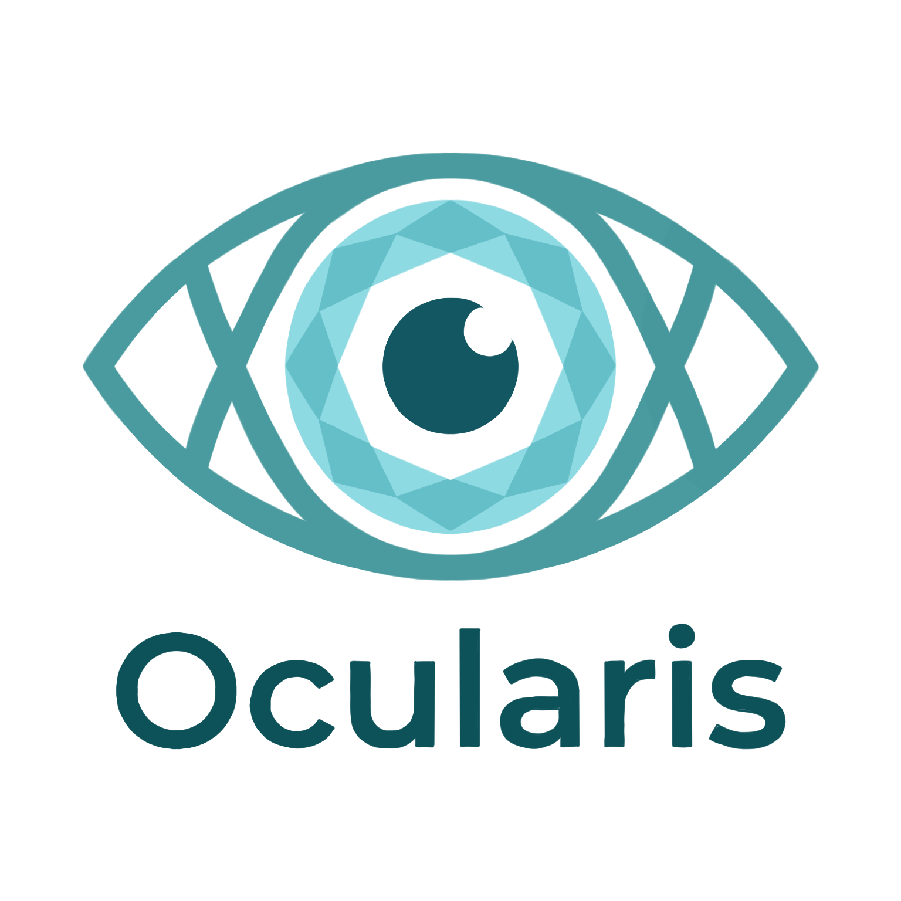
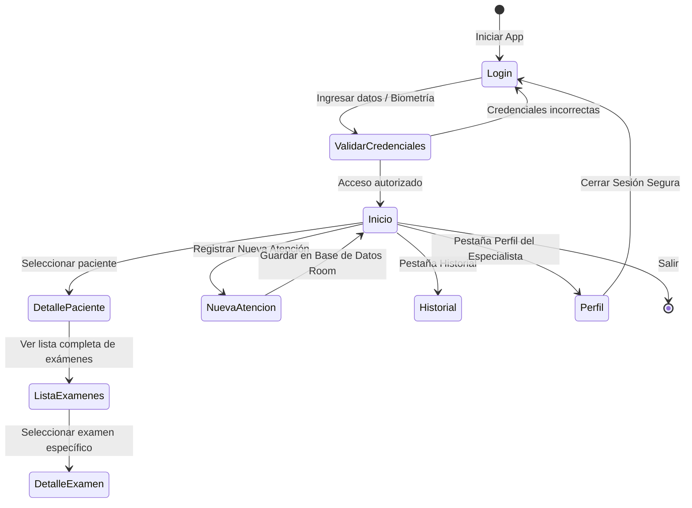

# Ocularis
**App móvil para consulta y trazabilidad de exámenes oftalmológicos**

Ocularis es una aplicación móvil desarrollada en Android (Jetpack Compose) orientada a centralizar, organizar y dar trazabilidad al acceso, gestión y consulta de exámenes e historiales clínicos oftalmológicos para especialistas y profesionales de la salud.

---

## 🎨 Identidad Visual
* **Logotipo:** 

  

* **Paleta de Colores Oficial:** 

| Color | Código | Vista Previa |
| :--- | :--- | :--- |
| **Fondo** | `#FFFFFA` |  |
| **Texto** | `#0D5C63` |  |
| **Secundario** | `#44A1A0` |  |
| **Adicional** | `#78CDD7` |  |
| **Principal** | `#247B7B` |  |

---

## 🏛️ Arquitectura y Base de Datos (3NF)
El proyecto implementa el patrón **MVVM (Model-View-ViewModel)** junto con **Room Database (SQLite)** normalizada en **Tercera Forma Normal (3NF)** para garantizar la persistencia local permanente:
* **Entidades (`Entities`):** `UsuarioEntity`, `PacienteEntity`, `EspecialistaEntity`, `AlertaClinicaEntity`, `ConsultaMedicaEntity`, `ExamenEntity`.
* **Acceso a Datos (`DAOs`):** Consultas reactivas basadas en **Kotlin Coroutines** y `Flow`.
* **Repositorio (`Repository`):** Capa única de verdad que alimenta al `AppViewModel`.
* **Poblador Inicial (`Seeder`):** Carga automática de registros clínicos de prueba al iniciar la aplicación.

---

## 📱 Pantallas Principales implementadas (MVP)
Todas las interfaces están construidas con **Jetpack Compose** y **Material 3**:
1. **Login (`LoginScreen.kt`):** Acceso seguro con validación dinámica acumulativa de contraseña (mínimo 8 caracteres, mayúsculas, minúsculas, números y caracteres especiales).
2. **Inicio / Pacientes (`HomeScreen.kt`):** Listado dinámico de pacientes recientes desde Room, barra de búsqueda y filtros rápidos.
3. **Nueva Atención (`AtencionScreen.kt`):** Formulario clínico para el registro de prestaciones médicas con selector de fecha nativo.
4. **Historial de Atenciones (`HistorialScreen.kt`):** Consulta global de exploraciones y exámenes sincronizados.
5. **Detalle del Paciente (`DetallePacienteScreen.kt`):** Expediente completo, datos de contacto, alertas oftalmológicas (miopía, glaucoma), próximo control e historial de consultas.
6. **Lista de Exámenes (`ListaExamenes.kt`):** Pantalla 5.5 intermedia para la consulta y filtrado de exámenes sincronizados desde PACS.
7. **Detalle del Examen (`DetalleExamen.kt`):** Visualizador de informes clínicos, hallazgos y acceso a documentos PDF firmados digitalmente.
8. **Perfil del Especialista (`PerfilScreen.kt`):** Panel del médico con estado de disponibilidad interactivo, estadísticas mensuales, credenciales y preferencias de consulta.

---

## ⚡ Recursos Nativos de Android Integrados
* **Biometría Nativa (`BiometricPrompt`):** Autenticación por huella dactilar o reconocimiento facial en el Login.
* **Telefonía y Mensajería (`Intent.ACTION_DIAL` / `smsto:`):** Llamadas y envío de SMS directos a los pacientes desde su perfil.
* **Compartir del Sistema (`Android ShareSheet`):** Envío de informes clínicos a otras aplicaciones mediante `Intent.ACTION_SEND`.
* **Impresión Nativa (`PrintManager`):** Conexión con el servicio de impresión del dispositivo.
* **Síntesis de Voz (`TextToSpeech`):** Lectura en voz alta en español del informe médico completo ("Escuchar Informe Completo 🔊").
* **Fecha y Hora (`DatePickerDialog`):** Selector de calendario nativo para agendamientos.

---

## 📊 Flujo de Usuario

## Pantallas Principales
Los diseños de las interfaces de Ocularis se encuentran ubicados en el repositorio dentro del directorio `docs/diseno/interfaces/`. Las pantallas generadas para este MVP son:
* Login
* Inicio / Búsqueda
* Registro de Atención
* Historial de Exámenes
* Registro de Examen (Subir Archivos)
* Resumen / Detalle

## Tecnologías Utilizadas
* **Google Stitch:** Generación y prototipado de UI con IA.
* **coolors.co:** Definición de la paleta de colores.
* **planttext.com:** Generación del diagrama de flujo UML.
* **Material Design 3 (m3.material.io):** Sistema de diseño y componentes base.

## Integrantes
**Equipo Bizcochitos**
* **Richard Hernández:** Líder
* **Cesar Molina:** Frontend
